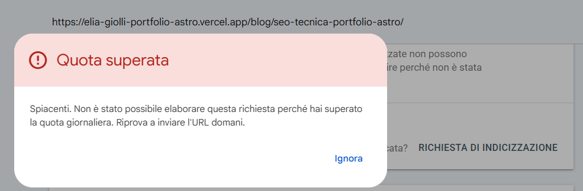
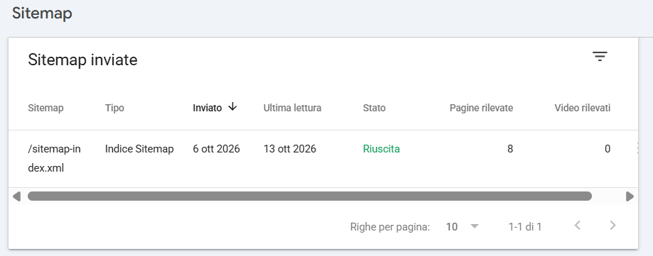
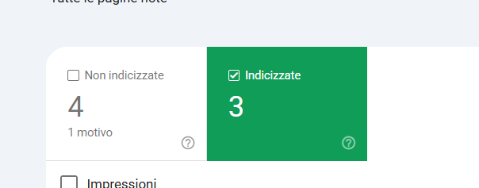
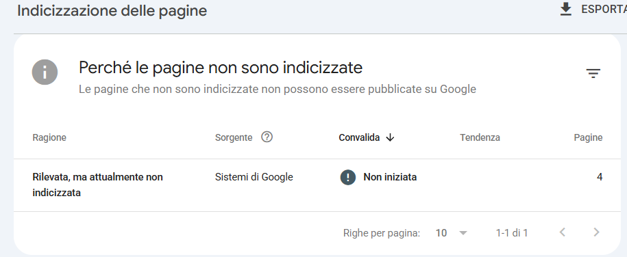

Lo ammetto: per qualche giorno ho pensato di dover pagare un abbonamento per far indicizzare il mio sito su Google.

Colpa di questo messaggio:

*Il messaggio che compare premendo "Richiedi indicizzazione".*

In questo articolo racconto come l'ho affrontato, con il metodo che usavo in help desk: partire dal sintomo, verificare un pezzo alla volta, e solo alla fine decidere se c'è davvero qualcosa da aggiustare. Spoiler: non c'era.

## Il sintomo

Dopo aver messo online il blog, ho collegato il sito a Google Search Console. Per prima cosa ho inviato la sitemap, poi ho usato il **Controllo URL** sulla homepage e ho premuto **Richiedi indicizzazione**.

Fin qui tutto bene.

Quando ho fatto lo stesso con la pagina di un articolo, è comparso il messaggio di quota superata. Ho pensato: aspetto domani. Ma il giorno dopo il messaggio si è ripresentato, anche al primo tentativo della giornata. E poi ancora il giorno dopo.

"Quota giornaliera" più "non si sblocca mai" mi ha fatto pensare a un limite gratuito da superare pagando. È qui che è nato il malinteso.

## La diagnosi, un passo alla volta

Prima di cercare una soluzione, volevo capire se il problema fosse davvero l'indicizzazione o qualcosa sul mio sito. Ho fatto tre verifiche.

### 1. Robots.txt e sitemap sono raggiungibili?

Sono due file pubblici, quindi chiunque può aprirli nel browser aggiungendo `/robots.txt` e `/sitemap-index.xml` all'indirizzo del sito. Il mio robots.txt permette la scansione di tutte le pagine e indica dove si trova la sitemap; la sitemap elenca le 8 pagine del sito. Per ricontrollarli mi sono fatto aiutare anche da un assistente AI, ma la verifica che conta è la prossima.

### 2. Google legge la sitemap?

Nel report **Sitemap** di Search Console la risposta è chiara: inviata il 6 ottobre, letta di nuovo da Google il 13, stato "Riuscita", 8 pagine rilevate.

*Google conosce tutte le pagine del sito.*

### 3. Cosa dice il report Pagine?

Nel report **Indicizzazione delle pagine**, dopo una settimana, 3 pagine risultano indicizzate.

*Dopo una settimana: 3 pagine indicizzate.*

Le altre 4 hanno un solo motivo: **"Rilevata, ma attualmente non indicizzata"**, con sorgente "Sistemi di Google".

*Google sa che quelle pagine esistono, ma non le ha ancora scansionate.*

Significa che Google ha trovato quelle pagine (grazie alla sitemap), ma non è ancora passato a scansionarle. E la sorgente "Sistemi di Google" indica che non si tratta di un errore del sito: è Google a decidere i tempi.

E l'ottava pagina della sitemap? Nel report non compare ancora: Google non l'ha ancora presa in considerazione. Le altre stanno entrando nell'indice un po' alla volta.

## La causa: un pulsante facoltativo, con un limite

La [guida di Google su come richiedere una nuova scansione](https://developers.google.com/search/docs/crawling-indexing/ask-google-to-recrawl) chiarisce tutto:

- esiste una quota per l'invio di singoli URL;
- richiedere più volte la scansione dello stesso URL non lo fa scansionare più velocemente;
- la scansione può richiedere da qualche giorno a qualche settimana;
- per molti URL, la strada consigliata è la sitemap.

Quindi:

- **Search Console è gratuita**, e la quota non si sblocca pagando: è un limite fisso sulle richieste manuali.
- **"Richiedi indicizzazione" è una scorciatoia facoltativa**, non un passaggio obbligatorio.
- **La strada principale è la sitemap**, che avevo già inviato e che funzionava.

## La soluzione: niente da aggiustare

Non ho cambiato niente sul sito. Ho smesso di premere quel pulsante e ho lasciato lavorare la sitemap.

Due cose da sapere, se ti trovi nella stessa situazione:

- **Non premere "Convalida correzione"** su "Rilevata, ma attualmente non indicizzata": serve dopo aver corretto un problema, e qui non c'è niente da correggere.
- **Quello che aiuta davvero** è pubblicare contenuti e collegare le pagine tra loro con link interni, come faccio tra [questo articolo sulla SEO tecnica del sito](/blog/seo-tecnica-portfolio-astro/) e il [case study dell'audit](/case-studies/audit-seo-tecnico-portfolio/).

## Cosa ho imparato

In help desk la prima regola era: prima di aggiustare, verifica che ci sia davvero qualcosa di rotto. Vale anche per la SEO. Un messaggio d'errore non sempre indica un problema: a volte indica solo il limite di uno strumento.

Il mio sito non aveva niente che non andasse. Era solo giovane.

Tornerò ad aggiornare questi numeri nelle prossime settimane, per vedere quanto tempo serve a Google per indicizzare tutte le pagine.
